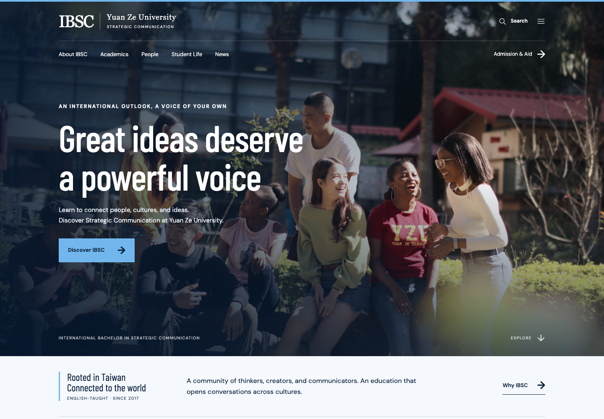
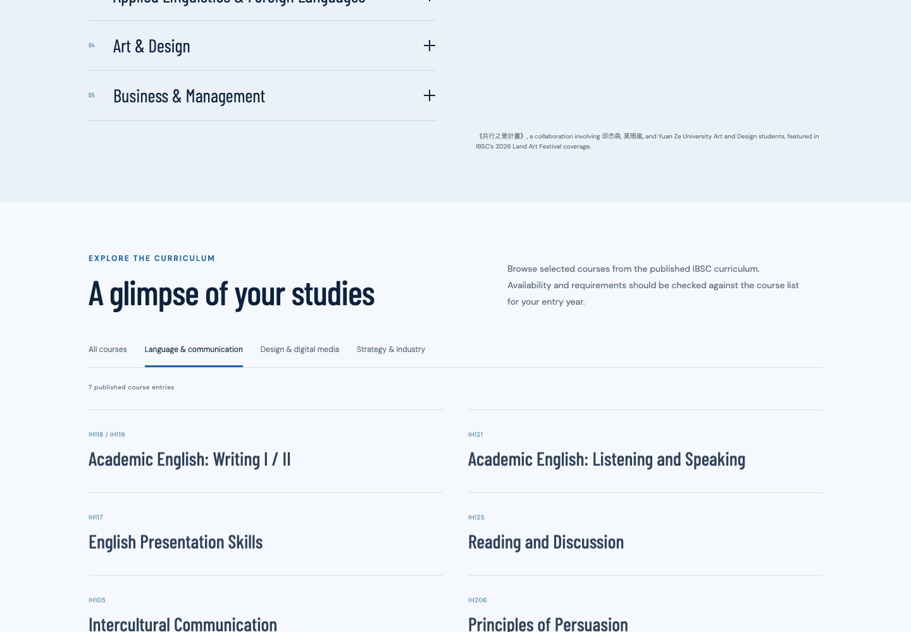
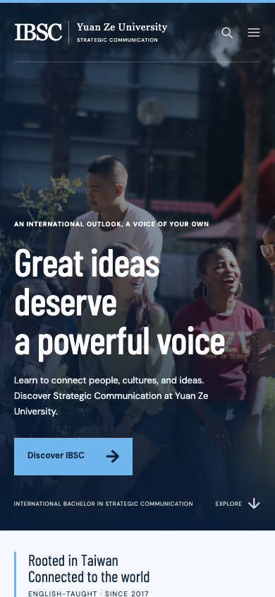

# IBSC Website Redesign · Yuan Ze University

A responsive editorial redesign for Yuan Ze University's International Bachelor in Strategic Communication, with structured content, searchable information, and accessible browser interactions.

**Publication status:** Private prototype review authorized by Jeremy Budianto for his professor. Jeremy reports involvement by the program Director. Permission to publish the source or university assets publicly has not been established; keep this repository private.



## Project overview

The project reorganizes program information around prospective students and the IBSC community. Its strongest technical feature is a small Python static-site generator: faculty profiles and news records feed multiple pages and the browser's search index from a single source of content.

The reviewed version contains 29 HTML files, including legacy addresses that redirect to information panels, six faculty records, and three news records. It runs as a static website. It has no database, account system, staff editing interface, or connected CMS.

## Features

- Responsive homepage, About, Academics, People, Student Life, News, Admissions, and resource views.
- Search across generated page descriptions, faculty profiles, stories, and resource panels.
- Faculty and news records reused across cards, full pages, related links, and search.
- An interactive news picture rail with manual controls and keyboard support.
- Expandable student experiences and resource guides with links that reveal the relevant panel.
- Application preparation routes that link out to the university's existing application portals.
- An Academics course browser with 13 published course examples and category filters.
- Local photography and fonts, reduced-motion support, skip navigation, and native disclosure elements.

Application routes provide information only; they do not submit applications or determine eligibility. Search is a local browser filter, not a remote search service. Accessibility features are implemented, but a complete accessibility audit has not been performed.

## Screenshots

These are authentic screenshots captured from a local copy on October 29, 2026. They are included for the authorized private prototype review. Public use of the university imagery has not been cleared.

| Desktop course filter | Mobile homepage |
| --- | --- |
|  |  |

## Technology stack

| Layer | Technology |
| --- | --- |
| Source generation | Python 3 standard library: pathlib, json, html, re |
| Structured content | JSON records and collections |
| Website | HTML5, CSS, plain JavaScript |
| Browser interfaces | Native dialogs, details/summary, DOM events, Web Animations API |
| Verification | Python unittest; local browser checks |
| Typography | Locally bundled Barlow Condensed and DM Sans |

No Node.js installation or package manager is required to build this source version.

## Architecture

```text
content/                       Structured site, homepage, faculty, news, and guide data
content_model.py               Load and validate records; derive routes and links
generate.py                    Generate core page layouts
home_components.py             Homepage rendering
faculty_components.py          Shared faculty rendering
academic_components.py         Academics rendering
interaction_components.py      News and student-experience rendering
admission_journey.py           Application guidance rendering
extend_pages.py                Build profiles, stories, guides, and search metadata
inline_panels.py               Consolidate guides into expandable panels
dist/                          Published HTML plus maintained CSS, JS, fonts, and images
tests/test_content_build.py    Content-workflow and internal-link tests
CMS-NOTES.md                   Content model and future CMS integration notes
```

`extend_pages.py` imports the core generator, renders additional pages, consolidates resource panels, and updates the search data in `dist/app.js`. Some static assets are maintained directly in `dist/`; retain that directory when transferring the source. It cannot be recreated from the Python and JSON files alone.

## Run locally

From a complete, authorized source checkout:

```sh
python3 extend_pages.py
python3 -m http.server 8000 --bind 127.0.0.1 --directory dist
```

Open `http://127.0.0.1:8000` in a browser. To check content workflows:

```sh
python3 -m unittest discover -s tests -v
```

## My contribution and AI-assisted development

Jeremy Budianto developed the concept and directed the product, visual design, website references, and desired features. Codex generated and revised the code to implement that direction. This description reflects Jeremy's account of his development process.

The implementation and screenshots document the resulting prototype. Verification listed below was performed during portfolio preparation.

## Verification

Review performed on October 29, 2026 using an isolated local copy:

- All seven existing content-workflow tests passed, including generated internal links, record changes, record retirement, and missing-image validation.
- Desktop search opened and returned a curriculum result.
- The Academics browser contained 13 entries; selecting Language & communication displayed seven.
- The mobile homepage at 390 × 844 had no horizontal page overflow.
- No JavaScript page errors occurred during those checks.

These checks do not establish production readiness or validate current university admission information.

## Rights, privacy, and publication

**Repository visibility: private.** Jeremy authorized uploading this prototype for his professor to review and reports involvement by the program Director. This authorization covers the private review requested here. Public source and asset redistribution permission remains unestablished; a public release requires a separate decision and rights review.

University photographs, portraits, branding, event coverage, and program information are present. Source provenance is recorded in `content/photography.json`, `content/academics.json`, faculty/news records, and the generated Sources page. Attribution records are not permission to redistribute. Staff contact details also need review before publication.

The source bundles Barlow Condensed and DM Sans. Their SIL Open Font License notices have been restored in `docs/licenses/` from the authoritative Google Fonts repository; see [third-party notices](THIRD_PARTY_NOTICES.md). No open-source license is asserted for the complete mixed-rights project.

If full source cannot be shared, prepare a separate, approved case study using permitted screenshots and a description of Jeremy's confirmed contributions. Do not publish restricted source or assets in that case study.
